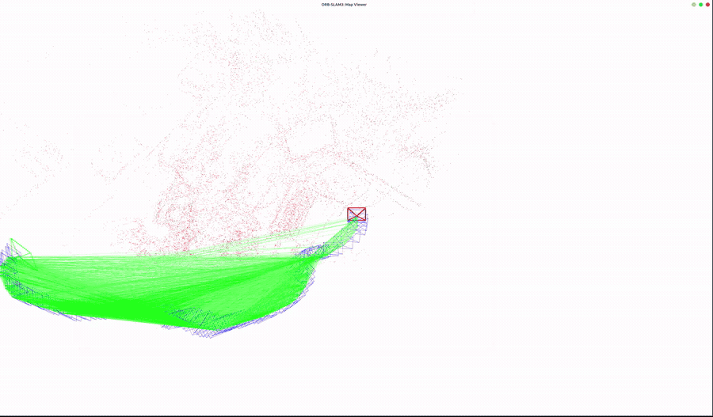

# ORB-SLAM3 RGB-D CUDA 演示

本仓库记录一次基于 DCH-SLAM 的 TUM `freiburg1_desk` RGB-D 离线 SLAM 演示。演示使用 CUDA ORB 前端处理同步 RGB-D 图像，并展示稀疏地图与相机关键帧轨迹。

## 实验结果

| 项目 | 结果 |
|---|---|
| 数据集 | TUM RGB-D `rgbd_dataset_freiburg1_desk` |
| 处理图像 | 573 帧 |
| 相机轨迹 | 573 个位姿 |
| 关键帧轨迹 | 402 个位姿 |
| ATE RMSE | 0.023424 m |
| 对齐方式 | SE(3)，不拟合尺度；573/573 个真值配对 |
| 验证环境 | Ubuntu 26.04.1、RTX 5070 Laptop GPU、CUDA 13.4 |

ATE 数值对应这一次序列回放和给定的时间戳关联，不代表其他数据、场景或硬件上的精度保证。演示中出现的地图点与关键帧由 SLAM 在线估计得到。

## 实现说明

原始实验目标指定的 `aliaxam153/ORB_SLAM3` 不包含 CUDA 前端，因此实验采用 [DCH-SLAM](https://github.com/datrich/DCH-SLAM) 的 `rgbd_tum` 路径。实验固定的 DCH-SLAM 上游 revision 为 `199a02517949afe8b4cd20aad8ab6e6ad51d3de5`，并使用了适配本机依赖及修复运行问题的本地修改。

DCH-SLAM 在 ORB-SLAM3 基础上还包含异步 YOLO 语义处理和自适应 Barron 鲁棒核等改动。因而这里展示的是该系统的 RGB-D 建图效果，不能作为“只启用 CUDA”带来加速或精度提升的公平对照。实验没有测量或宣称 CUDA 加速比。

## 数据与环境

数据来自 [TUM RGB-D fr1/desk](https://cvg.cit.tum.de/data/datasets/rgbd-dataset)。复现实验需要相应 RGB-D 序列、与传感器匹配的相机配置、ORB 词袋文件，以及可运行 DCH-SLAM RGB-D 示例的 C++/CUDA 环境。实验环境使用 OpenCV 4.10 和 Python 3.12；不同发行版、显卡架构和依赖版本可能需要调整构建配置。

## 仓库内容与复现范围

当前仓库提供本次实验的 README 和脱敏演示 GIF，不包含 DCH-SLAM 源码、构建脚本、数据集、模型权重或完整运行日志。因此它是实验结果展示页，不能单独完成构建或从零重放序列。运行需要按上文获取数据与上游实现，并针对目标 CUDA/依赖环境完成配置。

## 已知限制

- 结果来自单条静态室内序列的一次成功回放；不能推断动态场景鲁棒性或普遍定位精度。
- 该次回放没有触发跟踪丢失或新地图切换，因此相应恢复分支未被强制验证。
- 成功运行日志出现非致命 Qt timer 清理提示；本演示不代表所有 Qt 生命周期问题均已解决。
- 本项目聚焦视觉定位和稀疏建图，不包含目标规划、避障或机器人运动控制，不构成自主导航系统。
