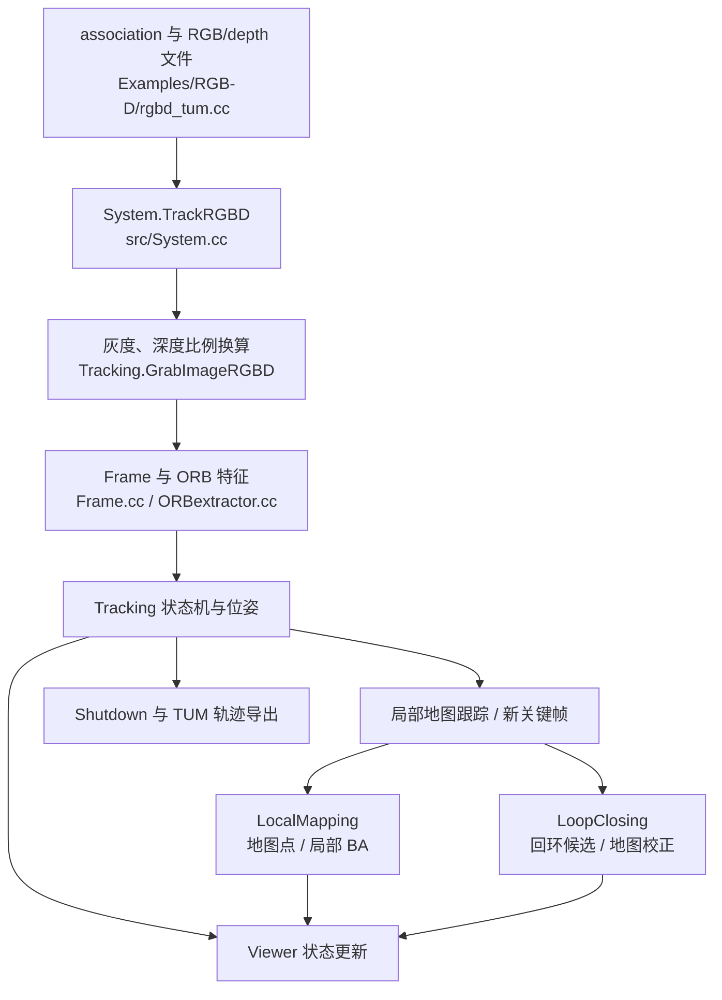
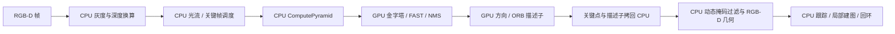

# ORB-SLAM3 RGB-D 源码导读

## 本地源码范围

- 本地已审计 checkout：Prompt 指定的 `aliaxam153/ORB_SLAM3` 分支归档，SHA-256 `76660dbe2a090d2fb98ed639c0dbf5aaa51abc4cc06106e2027e0a52cb0efaa1`。归档没有 `.git`，所以没有 commit/branch 元数据可查；该代码只作 CPU baseline。
- 用户选择的 CUDA 实现：[`datrich/DCH-SLAM`](https://github.com/datrich/DCH-SLAM)，用户终端 checkout revision `199a02517949afe8b4cd20aad8ab6e6ad51d3de5`。本文先列 Prompt 指定 fork 的 CPU baseline，再按本地 DCH checkout 补充 CUDA 前端调用链；两者是不同源码实现，不把 baseline 描述为 CUDA 版本。
- 已核对 DCH `src/Settings.cc`：RGB-D 相机焦距键为 `Camera1.fx`，深度因子键为 `RGBD.DepthMapFactor`。启动脚本按这套 DCH schema 校验自带 `Examples/RGB-D/TUM1.yaml`。
- DCH-SLAM 公开 CMake 声明 `USE_CUDA_FRONTEND`，在打开时启用 CUDA、构建 `src/cuda/*.cu` 组成的 `orbslam3_cuda` 并将其链接进 SLAM 库；同时提供 `Examples/RGB-D/rgbd_tum` target：[CUDA 配置与 targets](https://github.com/datrich/DCH-SLAM/blob/main/CMakeLists.txt)。这些为远端页面证据，须在取得源码后复核。

## 本地 CPU baseline 调用链

| 阶段 | 本地符号与位置 | 作用 |
|---|---|---|
| 程序入口 | `Examples/RGB-D/rgbd_tum.cc:33` `main`；`:46` 调用 `LoadImages`；`:148` 函数定义 | 读取 association 四列、RGB/depth 文件相对路径和 RGB 时间戳。 |
| 图像读取 | `Examples/RGB-D/rgbd_tum.cc:78-104` | `cv::imread` 读取成对图像，按时间戳向 SLAM 系统提交。 |
| 系统入口 | `src/System.cc:328` `System::TrackRGBD` | 检查 RGB-D 传感器模式，按配置调整图像尺寸并调用 tracker。 |
| 深度与灰度处理 | `src/Tracking.cc:1520` `Tracking::GrabImageRGBD` | 按 `Camera.RGB` 转灰度；按倒数深度因子把深度 PNG 转成米制浮点图。 |
| 帧构造 | `src/Frame.cc:201` RGB-D 构造函数 | 提取 ORB 特征，去畸变并从深度图计算 RGB-D 观测的深度/3D 信息。 |
| CPU ORB | `src/Frame.cc:419` `Frame::ExtractORB`；`src/ORBextractor.cc:781, 826` | 调用 CPU ORB extractor；构建多尺度图像金字塔并使用 FAST 特征检测。 |
| 跟踪状态机 | `src/Tracking.cc:1794` `Tracking::Track` | 初始化、参考关键帧/运动模型跟踪、局部地图跟踪及跟踪失败后的重定位。 |
| 局部地图与关键帧 | `src/Tracking.cc:2949, 3216, 3343` | `TrackLocalMap`、创建关键帧、搜索局部地图点。 |
| 局部建图 | `src/LocalMapping.cc:64` `Run`；`:298` `ProcessNewKeyFrame`；`:154` 调用 `Optimizer::LocalBundleAdjustment` | 处理关键帧、维护地图点、三角化和局部 BA。 |
| 词袋与重定位 | `src/Tracking.cc:3609` `Relocalization`；`:3617` 查询 `KeyFrameDatabase::DetectRelocalizationCandidates` | 用 ORB 词袋检索候选关键帧，尝试从跟踪丢失中恢复。 |
| 回环 | `src/LoopClosing.cc:90` `Run`；`:969` `CorrectLoop` | 后台处理关键帧和回环候选，校正地图；部分路径会启动全局 BA。 |
| 轨迹保存 | `src/System.cc:515` `Shutdown`；`:569` `SaveTrajectoryTUM`；`:629` `SaveKeyFrameTrajectoryTUM` | 关闭系统线程并写相机/关键帧 TUM 格式轨迹。示例在 `rgbd_tum.cc:142-143` 调用保存函数。 |

调用顺序可概括为：

该图对应本地 CPU checkout 的线程和模块概览。DCH CUDA 路径的实际调用点、数据传输与 CPU/GPU 边界已按本地 checkout 核对如下。

## DCH-SLAM CUDA 前端调用链（本地源码）

| 阶段 | DCH-SLAM 符号与位置 | 执行位置与行为 |
|---|---|---|
| RGB-D 输入 | `Examples/RGB-D/rgbd_tum.cc` → `System::TrackRGBD` (`src/System.cc`) | 读取 RGB/depth 帧和时间戳，交给 tracking。 |
| 灰度、深度与动态掩码 | `Tracking::GrabImageRGBD` (`src/Tracking.cc:1528-1613`)、`YOLO` (`src/YOLO.cc:19-20,168`) | OpenCV 在 CPU 转灰度、按 `RGBD.DepthMapFactor` 缩放深度；每 3 帧异步提交 YOLO 输入并消费已完成的掩码。DCH 明确将 OpenCV DNN backend/target 设为 CPU。 |
| 帧调度 | `Tracking::GrabImageRGBD` (`src/Tracking.cc:1615-1646`) | 初始化后的帧先走 CPU 光流；需要新关键帧时创建 RGB-D `Frame` 并提取 ORB。动态掩码决定选择常规或 DCH 动态特征数配置的 extractor。 |
| ORB 入口 | `Frame::ExtractORB` (`src/Frame.cc:542`) → `ORBextractor::operator()` (`src/ORBextractor.cc:1097-1156`) | 先在 CPU 调用 `ComputePyramid(image)`；编译启用 `USE_CUDA_FRONTEND` 时构造 `orb_cuda::ORB_GPU` 并调用 `extract`，不进入其后的旧 CPU FAST/描述子实现。 |
| GPU 图像与候选点 | `ORB_GPU::extract` (`src/cuda/orb_gpu.cpp:489-690`) | 把灰度图上传到 GPU；在多个 CUDA stream 上构建缩放金字塔，计算 FAST 分数并做 NMS、tile 候选筛选和多尺度抑制。 |
| GPU 方向与描述子 | `ORB_GPU::extract` (`src/cuda/orb_gpu.cpp:725-837`) | GPU 计算方向、Gaussian 图像和 ORB 描述子，打包关键点字段，并同步各层 stream。 |
| 拷回 CPU 与掩码过滤 | `ORBextractor::operator()` (`src/ORBextractor.cc:1127-1154`)、带 `imMask` 的 `Frame` 构造函数 (`src/Frame.cc:303-354`) | 关键点和描述子从 GPU 内存拷回 CPU 并转换为 OpenCV 类型；`Frame` 随后在 CPU 按动态掩码剔除命中的关键点。 |
| 几何与 SLAM 后端 | `Frame` RGB-D 构造函数；`Tracking::Track`、`LocalMapping`、`LoopClosing` | RGB-D 深度关联、位姿跟踪、地图维护、局部 BA 和回环仍由原 SLAM CPU 路径处理。 |

因此该实现只把 ORB 关键点检测和描述子前端放到 CUDA；灰度/深度处理、帧间光流、动态掩码过滤、深度几何及 SLAM 后端仍在 CPU。源码还会在调用 CUDA extractor 前计算 CPU 图像金字塔，同时 CUDA extractor 自己构建 GPU 金字塔；这条实现路径存在额外 CPU 工作，是否影响整体速度需由真实运行计时验证。异步 YOLO 明确使用 OpenCV CPU backend/target，不能仅凭代码存在推断 `fr1/desk` 的动态掩码输出或性能影响。

跟踪进入 `LOST` 并调用 `CreateMapInAtlas()` 时，DCH 会清空当前 `Frame` 并开始新地图。RGB-D wrapper 只有在上一帧位姿有效且跟踪状态已初始化时才启用 LK；若 map reset 返回空帧，则丢弃 LK 缓存，下一输入帧重新走 ORB 初始化。动态掩码的 LK 结果也在读取深度前检查有限值和图像边界。最终版本已完成 GPU 全序列回放；该成功运行没有触发 LOST→新地图，未单独强制验证这一分支。

## 概念与实验观察

- **相机位姿**：每个时间戳对应的相机在世界坐标中的位置和方向；TUM 轨迹每行含时间、平移和四元数。
- **关键帧**：被选来保留并参与地图优化的代表性帧。它不等同于每一张输入 RGB 图。
- **地图点**：由特征观测和 RGB-D 深度反投影出的稀疏三维点；稀疏地图与稠密重建不同。
- **局部 BA**：在局部关键帧窗口联合优化相机位姿和地图点，降低重投影残差。
- **重定位**：跟踪失败后根据当前帧特征检索已有关键帧并恢复位姿。单看轨迹连续不证明本次运行触发过重定位。
- **回环**：识别再次到达的旧地点并校正累积漂移；源码存在回环模块不代表 `fr1/desk` 本次一定检测到回环。
- **RGB-D 公制尺度**：深度图直接提供米制深度。TUM PNG 原始单位由 `DepthMapFactor=5000` 换算为米；评估时不应再自由拟合尺度。
- **ATE**：先按时间戳把估计轨迹和真值配对，再用 SE(3) 刚体对齐比较位置误差。脚本不估计 Sim(3) 尺度。

## 本次运行能观察到什么

最终成功运行 `20261017T082609Z` 完整处理 573 组关联，导出 573 条相机位姿和 402 条关键帧位姿，生成 XY/3D 图与 Pangolin 稀疏地图截图；ATE RMSE 0.023424 m。日志有连续帧 ID `0..572`、Shutdown 与两次轨迹保存，最终退出码为 0。没有记录 LK 匹配不足、local map 跟踪失败或第二张地图创建。成功日志仍有 Qt timer 清理警告，作为非致命兼容性问题保留。结果与原始日志见 [最终实验报告](experiment4_report.md)。

## SLAM 与导航边界

本演示只输出视觉 SLAM 的相机位姿和稀疏环境地图。完整自主导航还需目标点输入、路径规划、动态避障、定位/地图接口及运动控制。当前 Prompt 和代码没有证明这些组件已实现或联调，故不能称为自主导航。

## 进一步学习

1. 实际运行时，CPU 金字塔与 GPU 金字塔的重复计算对单帧延迟有多大影响？
2. 异步 YOLO 与深度线索怎样改变关键点权重或局部 BA 残差？静态 `fr1/desk` 中是否实际启用？
3. CUDA 前端相对原始 ORB-SLAM3 CPU 前端的速度、功耗和精度差异，应如何在相同数据、编译和运行条件下公平测量？
